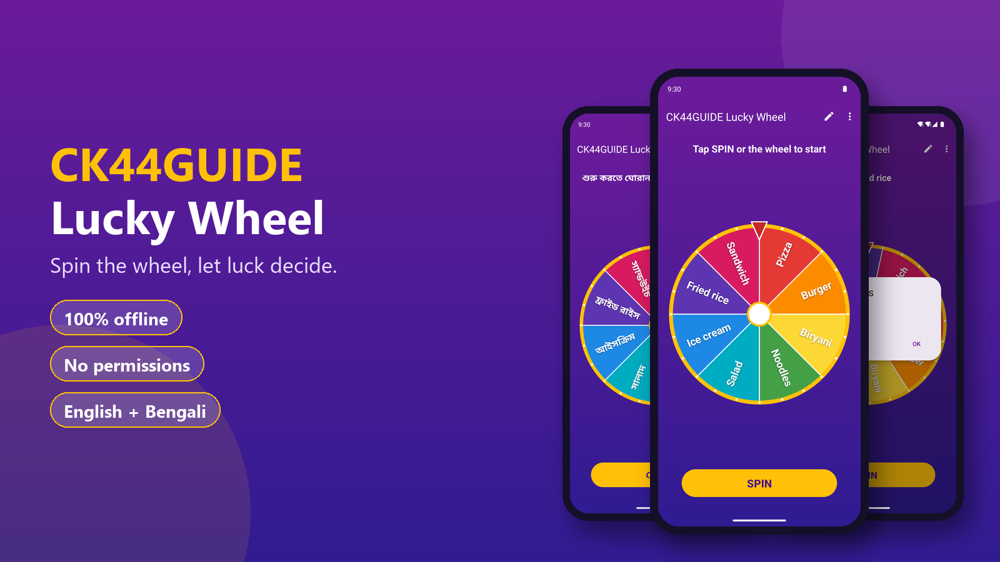
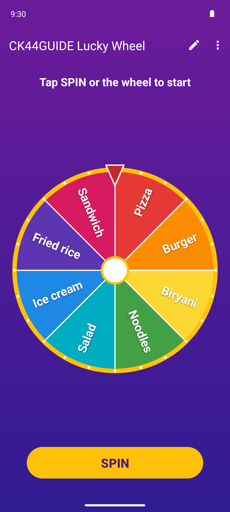
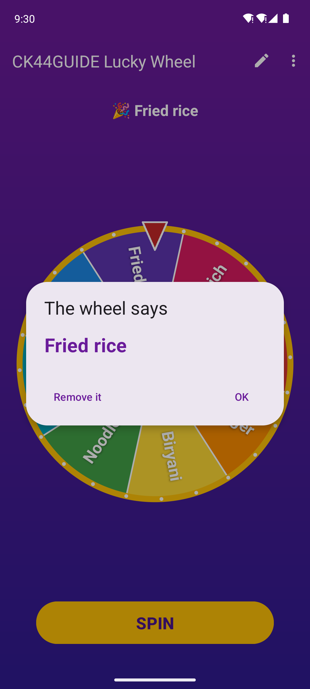
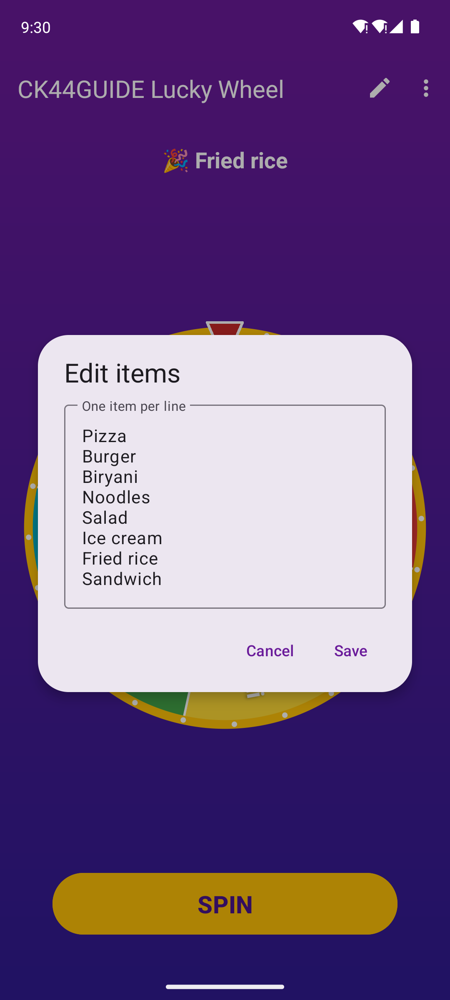
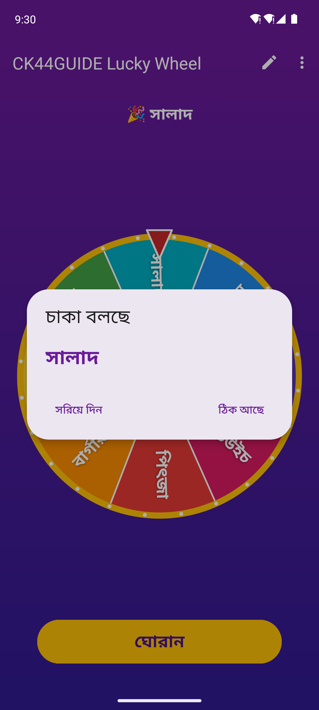

<p align="center">
  
</p>

<h1 align="center">CK44GUIDE Lucky Wheel</h1>

<p align="center">
  <b>Spin the wheel, let luck decide.</b><br>
  A colourful spinning-wheel picker for Android, in <b>English</b> and <b>বাংলা</b>.
</p>

<p align="center">
  
  
  
  
</p>

---

## Screenshots

<table>
  <tr>
    <td align="center"><br><sub>Home</sub></td>
    <td align="center"><br><sub>Spinning</sub></td>
    <td align="center"><br><sub>Result</sub></td>
  </tr>
  <tr>
    <td align="center"><br><sub>Edit your own items</sub></td>
    <td align="center"><br><sub>বাংলা: হোম</sub></td>
    <td align="center"><br><sub>বাংলা: ফলাফল</sub></td>
  </tr>
</table>

## Features

- 🎡 **Smooth, realistic spin:** the wheel slows down naturally, with a light haptic tick on every segment.
- ✏️ **Your own items:** 2 to 24 entries, one per line. Remove the winner after a spin, or reset to the defaults.
- 🌐 **Two languages:** English and Bengali. Follows the phone language, or switch any time from ⋮ → Language.
- 📴 **100% offline:** no internet, no ads, no tracking.
- 🔒 **No permissions:** the CI build fails if the APK ever requests one.
- 💾 Your items are saved on the device.

## Download

Every push to `main` builds a debug APK with GitHub Actions. Open the latest
**Build APK** run under the *Actions* tab and download the `lucky-wheel-debug-apk` artifact.

## Build it yourself

**Android Studio:** open this folder, let Gradle sync, then press Run.

**Command line** (JDK 17, Android SDK, Gradle 8.9):

```bash
gradle assembleDebug
```

The APK is written to `app/build/outputs/apk/debug/app-debug.apk`.

## Refreshing the screenshots

The screenshots are taken automatically on an Android emulator:

1. Run the **Screenshots** workflow from the *Actions* tab and download its `screenshots` artifact into `docs/screenshots/`.
2. Rebuild the banner: `python scripts/make-banner.py` (needs Pillow).

## Project layout

| Path | Purpose |
| --- | --- |
| `app/src/main/java/.../WheelView.kt` | Custom view that draws and animates the wheel |
| `app/src/main/java/.../MainActivity.kt` | Spin button, result dialog, item editor, language switch |
| `app/src/main/res/values/strings.xml` | English text |
| `app/src/main/res/values-bn/strings.xml` | Bengali text |
| `scripts/take-screenshots.sh` | Emulator script used by the Screenshots workflow |
| `scripts/make-banner.py` | Builds `docs/banner.png` from the screenshots |

Built with Kotlin, AndroidX AppCompat and Material 3. minSdk 26, targetSdk 34.
